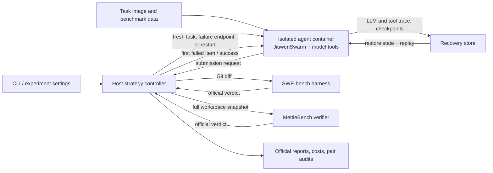

# JiuwenSwarm Rewind Bench

[中文 README](README.md)

This project feeds official benchmark verdicts back to JiuwenSwarm and compares three response strategies: Continue repairs in place, Restart starts over with failure feedback, and Rewind restores an earlier decision point. SWE-bench evaluates a Git patch; MettleBench evaluates the submitted workspace.

| Guide | Contents |
|---|---|
| [Setup and reproduction](docs/setup.en.md) | Linux/WSL, runtime installation, model credentials, data, and images |
| [JiuwenSwarm architecture and source](docs/jiuwenswarm.en.md) | Component diagrams, execution sequence, versions, and licensing |
| [Rewind mechanics](docs/rewind.en.md) | Checkpoints, replay, recovery boundaries, and auditing |
| [Use your own agent](docs/custom-agent.en.md) | Independent scoring, feedback, and recovery integration |
| [Experiments](docs/experiments.en.md) | Three-arm results, matched recovery outcomes, costs, and limitations |
| [Runtime source snapshot](runtime-source/README.en.md) | Browse all shipped Python source in the experimental distributions |

## Repository tree

```text
jiuwenswarm-rewind-bench/
├── bench_tools/
│   ├── jiuwenswarm_runtime/          # Feedback, replay, and recovery integration
│   ├── swebench_runner/              # Patch capture and SWE-bench evaluation
│   ├── mettlebench/                  # Full workspace evaluation and recovery pairs
│   ├── batch/                        # Batch orchestration helpers
│   └── net/                          # Container model egress
├── runtime-source/
│   ├── workswarm/jiuwenswarm/         # JiuwenSwarm distribution source
│   ├── openjiuwen/openjiuwen/         # agent-core distribution source
│   ├── replay_agent_recorder/replay/ # Replay distribution source
│   └── package/                      # Original manifest and legacy driver
├── tools/                            # Benchmark data and batch launchers
├── tests/                            # Offline regression and integration tests
└── docs/                             # Chinese and English guides
```

## System architecture



The host controls submission capture and official scoring. The agent works in a separate container. The score reports, recovery artifacts, and model cost are recorded separately so they can be compared per strategy.

A fresh clone can be configured without mirroring the original author's directory. Install the dependencies in the setup guide and download the [exact experimental runtime](https://github.com/qwqwqwqwqwqwqwqwqe/jiuwenswarm-rewind-bench/releases/tag/runtime-20261112-173855).

Across 76 comparable MettleBench tasks, Continue, Restart, and Rewind solved **71, 73, and 72**. On the matched Bat endpoint, Continue failed the same criterion five more times; Rewind recovered the original cache input and passed its first new evaluation.

Upstream: [SWE-bench](https://github.com/SWE-bench/SWE-bench) · [MettleBench](https://github.com/Kelvin-Coffee/MettleBench) · [JiuwenSwarm](https://github.com/openJiuwen-ai/jiuwenswarm) · [AgentRewind](https://arxiv.org/abs/2608.14380)
