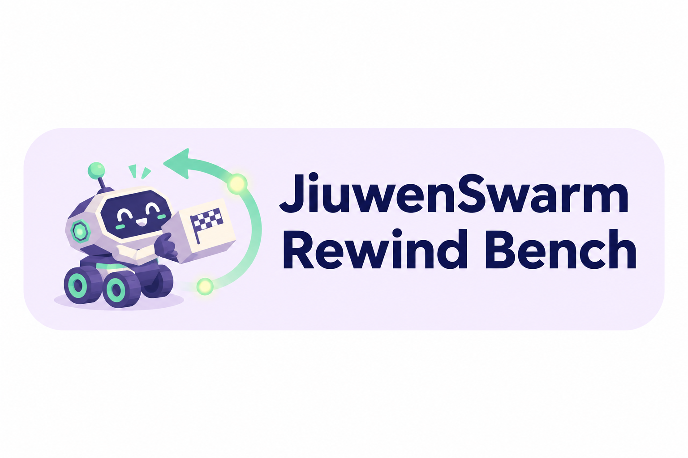
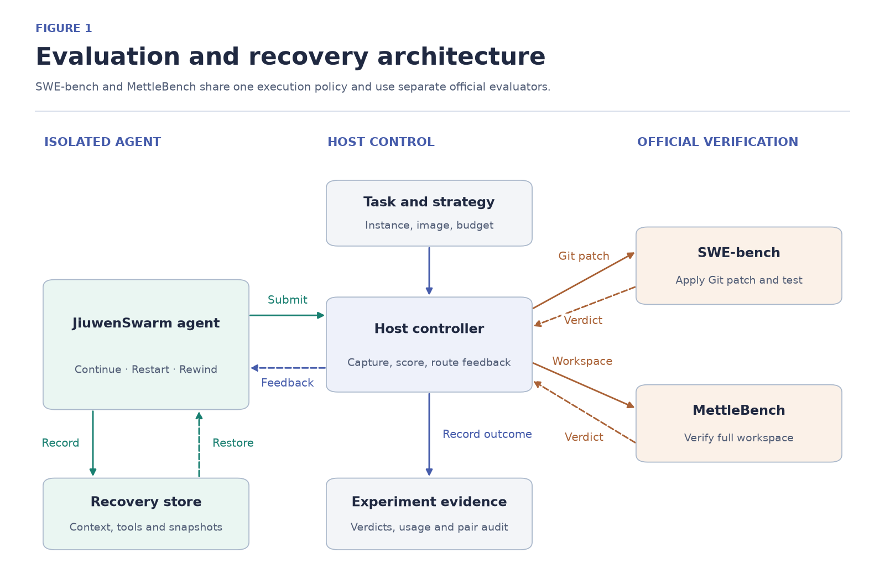

# JiuwenSwarm Rewind Bench

<p align="center">
  
</p>

<p align="center">
  <a href="docs/setup.md">配置指南</a>
  · <a href="README.en.md">English README</a>
  · <a href="https://github.com/qwqwqwqwqwqwqwqwqe/jiuwenswarm-rewind-bench/releases/tag/runtime-20261112-173855">运行时 ZIP</a>
</p>

<p align="center">
  <a href="docs/setup.md"></a>
  <a href="docs/setup.md"></a>
  <a href="https://github.com/SWE-bench/SWE-bench"></a>
  <a href="https://github.com/Kelvin-Coffee/MettleBench"></a>
</p>

将官方验收反馈接入 JiuwenSwarm，对比 Continue 原地修复、Restart 带失败反馈重启和 Rewind 检查点回退。SWE-bench 验收 Git 补丁，MettleBench 验收完整任务工作区。

| 文档 | 内容 |
|---|---|
| [环境配置与复现](docs/setup.md) | 从干净 clone 安装 runtime、配置模型、获取两套 benchmark 的镜像 |
| [JiuwenSwarm 集成与源码](docs/jiuwenswarm.md) | 解压源码、原版 ZIP、版本、许可证和旧 driver |
| [回退机制](docs/rewind.md) | 检查点、历史重放、恢复边界与审计 |
| [接入自己的 agent](docs/custom-agent.md) | 独立评分、在线反馈与原生回退需要的适配 |
| [实验报告](docs/experiments.md) | 三臂结果、同失败终点配对、重复实验与局限 |

从新 clone 可以按文档配置，无需复制原作者的目录。运行还需要 Python 3.12、Docker、模型端点、基准数据和 [原版 runtime ZIP](https://github.com/qwqwqwqwqwqwqwqwqe/jiuwenswarm-rewind-bench/releases/tag/runtime-20261112-173855)。SWE-bench 官方反馈控制器直接启动实验 agent，旧 BenchRunner backend 可选。

## 实验贡献：异步混合回退候选

最近窗口可能被长时间修复中的相似决策占满，让破坏性操作之前的检查点失去可见性。混合策略对**已经录制的 LLM 检查点**建立语义索引。每轮工具执行只要有 Git tree 变化，就将整轮动作和近期验证证据交给后台模型，判断是否开启新的子目标。查询在同一候选预算内优先保留最近 8 个点、受保护的变更和失败编辑、语义段首及段尾。查询最多等待后台约 2 秒，无成功判定时使用最近窗口。

### 同失败起点对照

从归档的失败工作区与上下文启动两种 Rewind 策略，由官方 verifier 验收。每个任务、策略和预算组合运行一次。

| Case | Recent 20 | Hybrid 20 | Recent 40 | Hybrid 40 | Recent 80 | Hybrid 80 |
|---|---|---|---|---|---|---|
| Bat | FAIL | PASS | FAIL | PASS | PASS | PASS |
| Ctags | FAIL | PASS | FAIL | PASS | — | — |
| Age | FAIL | PASS | FAIL | PASS | FAIL | PASS |

**20 和 40 个候选的定向对照中，混合策略各通过 3/3，最近窗口各通过 0/3。** Age 的 20、40、80 混合臂都选中了默认迁移前的 `rec_000031`，恢复后通过字节保留验收。Ctags 在两档小窗口都回到 `rec_000042`。Bat 的两档混合臂都回到 `rec_000053` 并通过，说明预设目标的可见性和实际选点应分别记录。这些对照支持混合策略在所测归档失败现场的实用性。三道题是定向选取的，独立 76 题三臂结果使用原统计口径。 [逐臂结果](docs/candidate-results.json) · [语义索引实现](bench_tools/jiuwenswarm_runtime/semantic_candidates.py) · [复现步骤](docs/hybrid-candidates.md)


## 目录结构

```text
jiuwenswarm-rewind-bench/
├── bench_tools/
│   ├── jiuwenswarm_runtime/          # Feedback, replay, and recovery integration
│   ├── swebench_runner/              # Patch capture and SWE-bench evaluation
│   ├── mettlebench/                  # Full workspace evaluation and recovery pairs
│   ├── batch/                        # Batch orchestration helpers
│   └── net/                          # Container model egress
├── runtime-source/
│   ├── workswarm/jiuwenswarm/         # JiuwenSwarm distribution source
│   ├── openjiuwen/openjiuwen/         # agent-core distribution source
│   ├── replay_agent_recorder/replay/ # Replay distribution source
│   └── package/                      # Original manifest and legacy driver
├── tools/                            # Benchmark data and batch launchers
├── tests/                            # Offline regression and integration tests
└── docs/                             # Chinese and English guides
```

## 项目架构



宿主控制器负责收集交付物并调度官方验收。Agent 在独立容器运行，恢复轨迹与验收报告分别记录，便于核对各分支的动作和结果。

MettleBench 的 76 个可比任务中，Continue、Restart、Rewind 分别通过 **71、73、72** 个。Bat 从相同失败终点出发，Continue 又连续五次失败，Rewind 找回原始缓存输入后首次新提交通过。[结果和成本](docs/experiments.md)

上游项目：[SWE-bench](https://github.com/SWE-bench/SWE-bench) · [MettleBench](https://github.com/Kelvin-Coffee/MettleBench) · [JiuwenSwarm](https://github.com/openJiuwen-ai/jiuwenswarm) · [AgentRewind](https://arxiv.org/abs/2608.14380)
