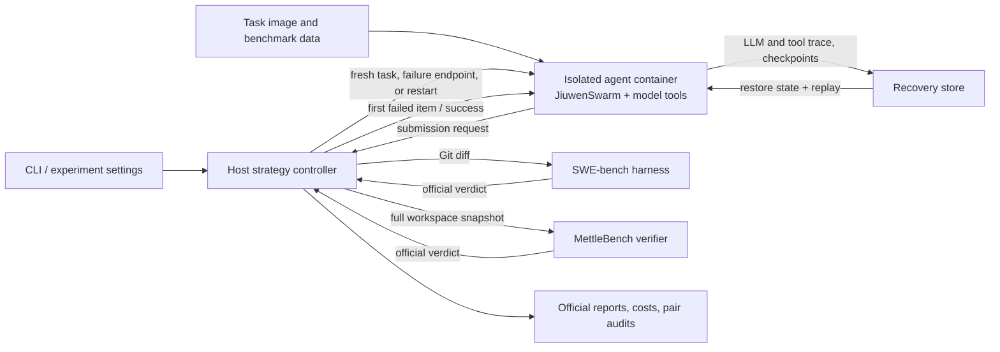

# JiuwenSwarm Rewind Bench

[English README](README.en.md) · [完整运行时源码](runtime-source/)

将官方验收反馈接入 JiuwenSwarm，对比 Continue 原地修复、Restart 带失败反馈重启和 Rewind 检查点回退。SWE-bench 验收 Git 补丁，MettleBench 验收完整任务工作区。

| 文档 | 内容 |
|---|---|
| [环境配置与复现](docs/setup.md) | 从干净 clone 安装 runtime、配置模型、获取两套 benchmark 的镜像 |
| [JiuwenSwarm 集成与源码](docs/jiuwenswarm.md) | 解压源码、原版 ZIP、版本、许可证和旧 driver |
| [回退机制](docs/rewind.md) | 检查点、历史重放、恢复边界与审计 |
| [接入自己的 agent](docs/custom-agent.md) | 独立评分、在线反馈与原生回退需要的适配 |
| [实验报告](docs/experiments.md) | 三臂结果、同失败终点配对、重复实验与局限 |

从新 clone 可以按文档配置，无需复制原作者的目录。运行还需要 Python 3.12、Docker、模型端点、基准数据和 [原版 runtime ZIP](https://github.com/qwqwqwqwqwqwqwqwqe/jiuwenswarm-rewind-bench/releases/tag/runtime-20261112-173855)。SWE-bench 官方反馈控制器直接启动实验 agent，旧 BenchRunner backend 可选。

## 目录结构

```text
jiuwenswarm-rewind-bench/
├── bench_tools/
│   ├── jiuwenswarm_runtime/          # Feedback, replay, and recovery integration
│   ├── swebench_runner/              # Patch capture and SWE-bench evaluation
│   ├── mettlebench/                  # Full workspace evaluation and recovery pairs
│   ├── batch/                        # Batch orchestration helpers
│   └── net/                          # Container model egress
├── runtime-source/
│   ├── workswarm/jiuwenswarm/         # JiuwenSwarm distribution source
│   ├── openjiuwen/openjiuwen/         # agent-core distribution source
│   ├── replay_agent_recorder/replay/ # Replay distribution source
│   └── package/                      # Original manifest and legacy driver
├── tools/                            # Benchmark data and batch launchers
├── tests/                            # Offline regression and integration tests
└── docs/                             # Chinese and English guides
```

## 项目架构



宿主控制器负责收集交付物并调度官方验收。Agent 在独立容器运行，恢复轨迹与验收报告分别记录，便于核对各分支的动作和结果。

MettleBench 的 76 个可比任务中，Continue、Restart、Rewind 分别通过 **71、73、72** 个。Bat 从相同失败终点出发，Continue 又连续五次失败，Rewind 找回原始缓存输入后首次新提交通过。[结果和成本](docs/experiments.md)

上游项目：[SWE-bench](https://github.com/SWE-bench/SWE-bench) · [MettleBench](https://github.com/Kelvin-Coffee/MettleBench) · [JiuwenSwarm](https://github.com/openJiuwen-ai/jiuwenswarm) · [AgentRewind](https://arxiv.org/abs/2608.14380)
