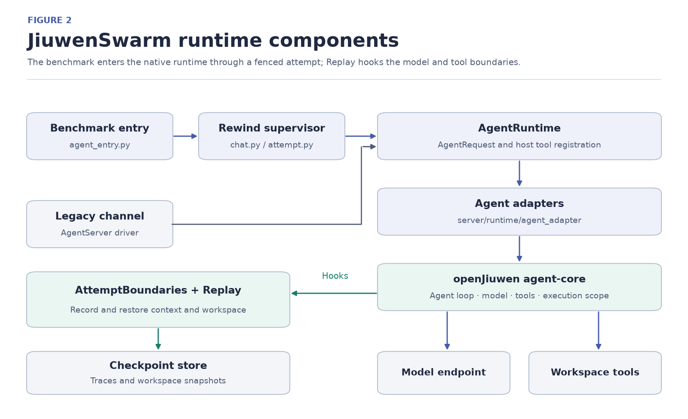
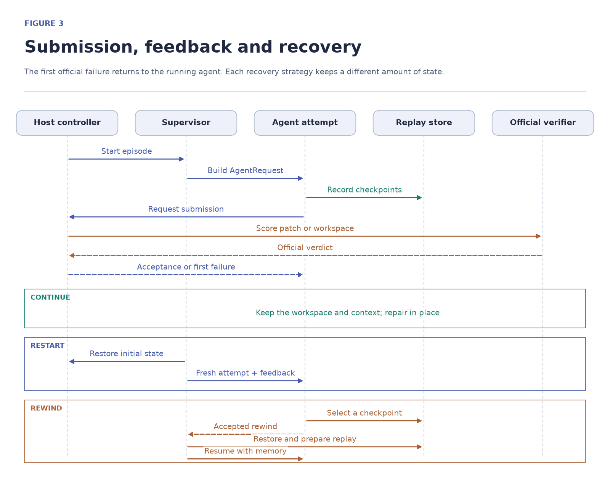

# JiuwenSwarm integration and architecture

[中文](jiuwenswarm.md) · [Home](../README.en.md)

## Components

- `agent_entry.py` owns the benchmark episode and translates settings into an AgentRequest. The Rewind supervisor starts and fences attempt processes.
- `AgentRuntime` manages the agent request. The [agent adapters](../runtime-source/workswarm/jiuwenswarm/server/runtime/agent_adapter/) connect the runtime to particular agent modes. `interface_deep.py` is one implementation in that directory.
- [agent-core](../runtime-source/openjiuwen/openjiuwen/) provides model, tool, agent loop, and execution-scope APIs. [Replay](../runtime-source/replay_agent_recorder/replay/) records and restores supported boundaries.
- The feedback overlay adds the benchmark submission tool. The verifier runs separately under host control. The legacy AgentServer driver has a separate integration path described in the packaged guide.

## Sequence after official evaluation

Continue and Rewind both receive the first failed criterion. A rewind only happens after a model-selected checkpoint is accepted. Strict replay uses recorded responses and results instead of rerunning old side-effecting commands.

## Exact experimental distributions

| Component | Version | Upstream |
|---|---|---|
| JiuwenSwarm | `0.2.5b1+rewind.bench.20261112.retry1` | [JiuwenSwarm](https://github.com/openJiuwen-ai/jiuwenswarm) |
| openJiuwen / agent-core | `0.1.20+rewind.bench.20261110` | [agent-core](https://gitcode.com/openJiuwen/agent-core) |
| Replay recorder | `1.0.0a1+rewind.20261112.escape1` | [replay-agent-recorder](https://github.com/Futuresis/replay-agent-recorder) |

Browse the extracted source in [runtime-source](../runtime-source/README.en.md). The build [manifest](../runtime-source/package/manifest.json) records upstream commits and wheel hashes. Some builds included local changes. Install the original matching wheels from the [release](https://github.com/qwqwqwqwqwqwqwqwqe/jiuwenswarm-rewind-bench/releases/tag/runtime-20261112-173855) using the [setup guide](setup.en.md). The historical AgentServer path also requires the legacy driver patch in the original bundle.
