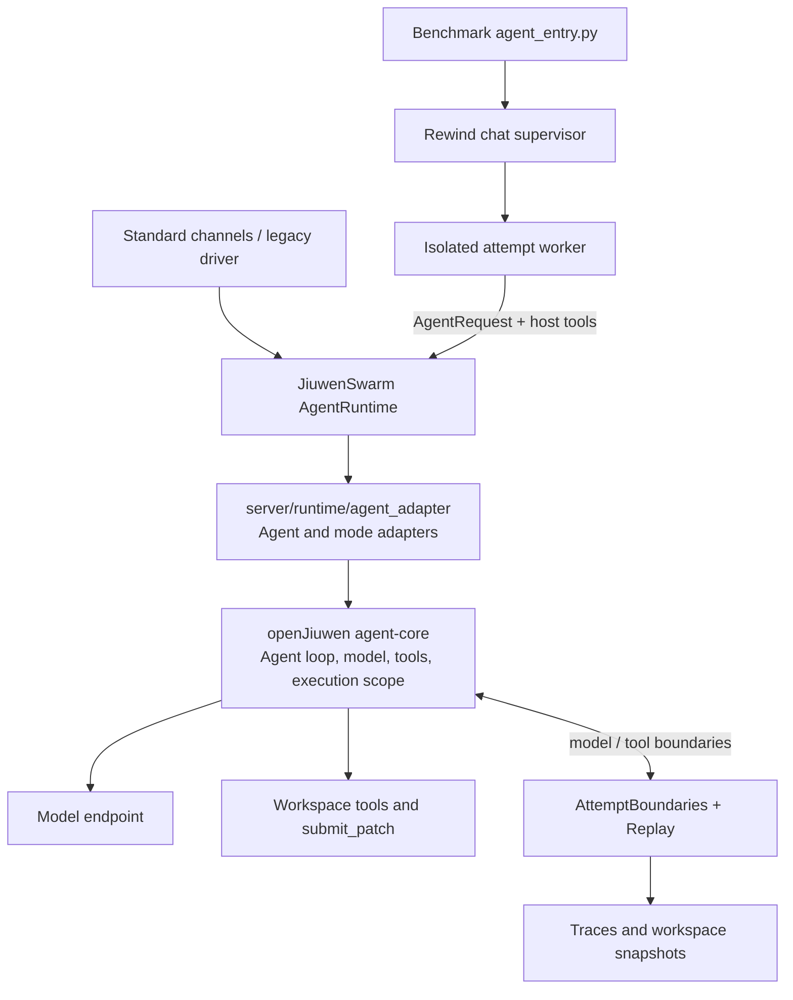
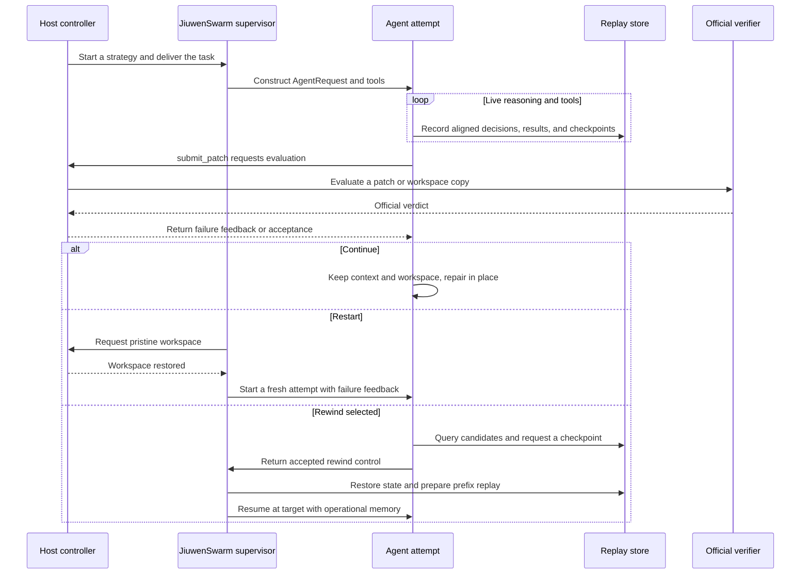

# JiuwenSwarm 集成和源码

[English](jiuwenswarm.en.md) · [首页](../README.md)

## JiuwenSwarm 组件图

- `agent_entry.py` 把实验参数转成 AgentRequest，回退 supervisor 管理尝试进程。
- `AgentRuntime` 通过 [agent_adapter](../runtime-source/workswarm/jiuwenswarm/server/runtime/agent_adapter/) 连接不同 Agent 模式。`interface_deep.py` 是其中一个实现。
- [agent-core](../runtime-source/openjiuwen/openjiuwen/) 提供 Agent 循环、模型、工具和执行作用域。Replay 负责记录模型和工具边界及工作区快照。

## 提交、反馈与恢复顺序图

Continue 保留当前上下文。Restart 恢复初始工作区并用新会话处理失败反馈。Rewind 由模型选择较早决策，恢复工作区并重放历史结果，到目标点才重新调用模型。

`bench_tools/jiuwenswarm_runtime/` 实现宿主与容器的反馈协议。容器内 `agent_entry.py` 构造 JiuwenSwarm Request 并启动真实 Agent。提交工具写 IPC 请求，宿主在隔离环境评分并返回首个失败项。实验覆盖层处理候选路径、模型响应重试、记忆与提交工具。

- [runtime-source](../runtime-source/) 收录三个 wheel 的全部 Python 源码，包括 JiuwenSwarm 完整 Agent 适配目录、agent-core 和 Replay。
- [完整 runtime ZIP](https://github.com/qwqwqwqwqwqwqwqwqe/jiuwenswarm-rewind-bench/releases/tag/runtime-20261112-173855) 包含三个原始 wheel 和完整验证工具，按[安装文档](setup.md)使用。

| 组件 | 实验发行版本 | 上游 |
|---|---|---|
| JiuwenSwarm | 0.2.5b1+rewind.bench.20261112.retry1 | [JiuwenSwarm](https://github.com/openJiuwen-ai/jiuwenswarm) |
| openJiuwen | 0.1.20+rewind.bench.20261110 | [agent-core](https://gitcode.com/openJiuwen/agent-core) |
| Replay recorder | 1.0.0a1+rewind.20261112.escape1 | [replay-agent-recorder](https://github.com/Futuresis/replay-agent-recorder) |

基线提交和哈希见 [manifest](../runtime-source/package/manifest.json)。原包记录部分组件构建时含未提交改动，使用相应 wheel 可保留实际实验版本。第三方许可和 NOTICE 随组件保留。

独立反馈入口直接在容器调用 JiuwenSwarm。通过 AgentServer chat_send 的旧路线仍可参阅[包内驱动接入说明](../runtime-source/package/INSTALL_ZH.md)，该路线依赖原 BenchRunner backend 与 driver 补丁，使用独立运行根。
